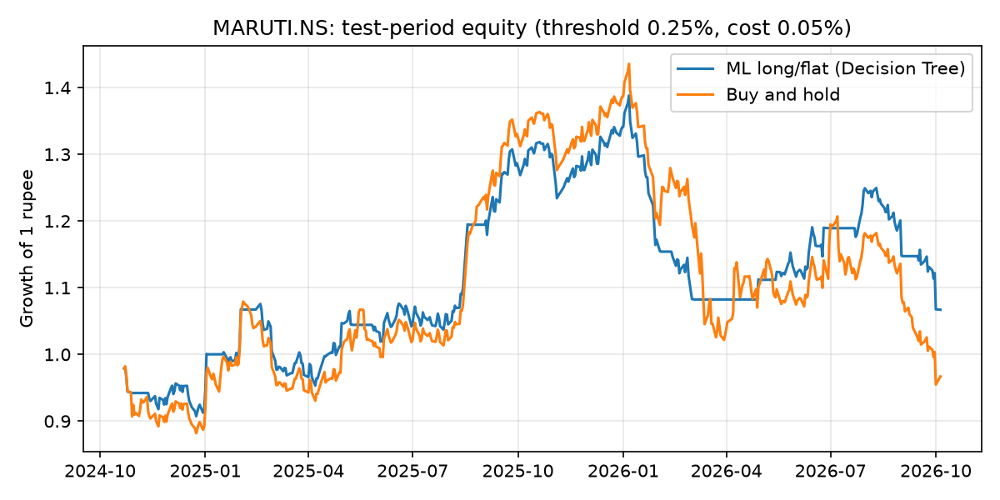

# Results: MARUTI.NS

- Source: Yahoo Finance via yfinance, period=10y
- Rows used: 2415 (from 2471); 2016-12-23 → 2026-10-05
- Horizon: 5 trading days; features: 61
- Peers used: MOTHERSON.NS, BOSCHLTD.NS, UNOMINDA.NS, ENDURANCE.NS, MRF.NS, APOLLOTYRE.NS, EXIDEIND.NS, TATASTEEL.NS, JSWSTEEL.NS, ^NSEI
- Split: train 2016-12-23 → 2022-10-25; validation 2022-11-03 → 2024-10-11; test 2024-10-21 → 2026-10-05
- Best model on validation: **Decision Tree** ({'max_depth': 3, 'min_samples_leaf': 30})
- Test RMSE 3.470% vs predict-0 baseline 3.375% → does NOT beat baseline

## Test metrics
| Model                     |   RMSE (%) |   MAE (%) | Direction accuracy (%)   |   Skill vs predict-0 (%) |   Validation RMSE (%) |
|:--------------------------|-----------:|----------:|:-------------------------|-------------------------:|----------------------:|
| Random Forest             |      3.356 |     2.511 | 53.623                   |                    1.121 |                 2.706 |
| Baseline: predict 0       |      3.375 |     2.493 | —                        |                    0     |                 2.736 |
| Gradient Boosting         |      3.385 |     2.517 | 51.967                   |                   -0.562 |                 2.762 |
| Elastic Net               |      3.387 |     2.518 | 48.654                   |                   -0.71  |                 2.713 |
| Baseline: historical mean |      3.387 |     2.518 | 48.654                   |                   -0.71  |                 2.713 |
| Decision Tree             |      3.47  |     2.578 | 51.553                   |                   -5.723 |                 2.702 |

## Do peers help? (same model, with vs without)
| Model                                        |   RMSE (%) |   MAE (%) |   Direction accuracy (%) |   Skill vs predict-0 (%) |   Features |
|:---------------------------------------------|-----------:|----------:|-------------------------:|-------------------------:|-----------:|
| Decision Tree — Own features only            |       3.47 |     2.578 |                   51.553 |                   -5.723 |         11 |
| Decision Tree — Own + supplier/peer features |       3.47 |     2.578 |                   51.553 |                   -5.723 |         61 |

## Importance by source
| Source           |   Importance |   Share (%) |
|:-----------------|-------------:|------------:|
| Own price/volume |        0.669 |      66.913 |
| MOTHERSON.NS     |        0.331 |      33.087 |
| APOLLOTYRE.NS    |        0     |       0     |
| ENDURANCE.NS     |        0     |       0     |
| BOSCHLTD.NS      |        0     |       0     |
| JSWSTEEL.NS      |        0     |       0     |
| EXIDEIND.NS      |        0     |       0     |
| MRF.NS           |        0     |       0     |
| TATASTEEL.NS     |        0     |       0     |
| UNOMINDA.NS      |        0     |       0     |
| ^NSEI            |        0     |       0     |

## Strategy (threshold 0.25%, cost 0.05%)
| Strategy                     |   Total return (%) |   Annual return (%) |   Annual volatility (%) |   Sharpe ratio |   Max drawdown (%) |   Trades |   Time in market (%) |
|:-----------------------------|-------------------:|--------------------:|------------------------:|---------------:|-------------------:|---------:|---------------------:|
| ML long/flat (Decision Tree) |              6.699 |               3.448 |                  17.821 |          0.278 |            -23.133 |       32 |               70.747 |
| Buy and hold                 |             -3.302 |              -1.74  |                  22.838 |          0.037 |            -33.493 |        1 |              100     |

## Threshold sensitivity
| Rule                        |   Total return (%) | Sharpe ratio   |   Max drawdown (%) |   Trades |   Time in market (%) |
|:----------------------------|-------------------:|:---------------|-------------------:|---------:|---------------------:|
| ML, buy if forecast > 0%    |              6.699 | 0.278          |            -23.133 |       32 |               70.747 |
| ML, buy if forecast > 0.25% |              6.699 | 0.278          |            -23.133 |       32 |               70.747 |
| ML, buy if forecast > 0.5%  |              6.699 | 0.278          |            -23.133 |       32 |               70.747 |
| ML, buy if forecast > 1%    |              0     | —              |              0     |        0 |                0     |
| Buy and hold                |             -3.302 | 0.037          |            -33.493 |        1 |              100     |

## Walk-forward (5 periods)
| Model                     |   Mean RMSE (%) |   Worst fold RMSE (%) | Mean direction acc. (%)   | Folds beating predict-0   |
|:--------------------------|----------------:|----------------------:|:--------------------------|:--------------------------|
| Baseline: historical mean |           3.335 |                 4.483 | 51.081                    | 4 / 5                     |
| Baseline: predict 0       |           3.34  |                 4.502 | —                         | —                         |
| Random Forest             |           3.376 |                 4.669 | 51.323                    | 2 / 5                     |
| Elastic Net               |           3.393 |                 4.411 | 49.595                    | 1 / 5                     |
| Gradient Boosting         |           3.429 |                 4.708 | 52.153                    | 2 / 5                     |
| Decision Tree             |           3.63  |                 5.64  | 50.829                    | 0 / 5                     |

## Test RMSE (%) by horizon
| Model                     |   h=1 |   h=5 |   h=20 |
|:--------------------------|------:|------:|-------:|
| Baseline: predict 0       | 1.44  | 3.375 |  7.544 |
| Elastic Net               | 1.441 | 3.387 |  7.594 |
| Baseline: historical mean | 1.441 | 3.387 |  7.594 |
| Random Forest             | 1.448 | 3.356 |  7.359 |
| Gradient Boosting         | 1.485 | 3.385 |  7.314 |
| Decision Tree             | 1.496 | 3.47  |  8.283 |

