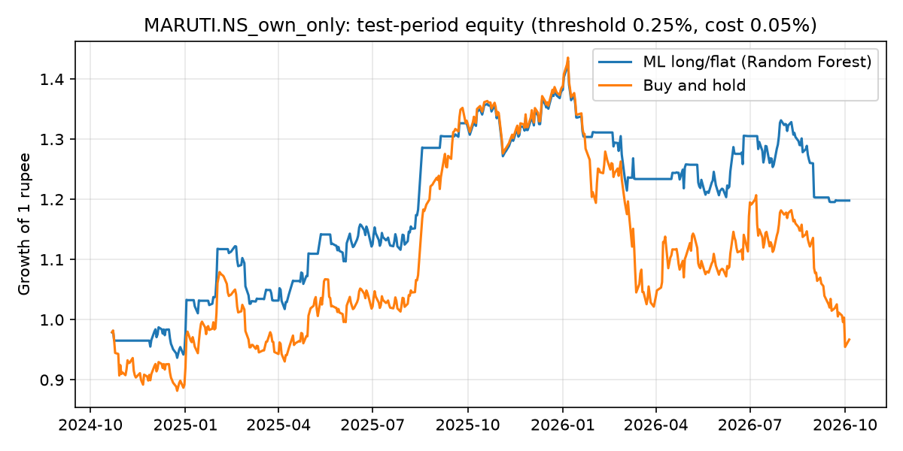

# Results: MARUTI.NS_own_only

- Source: Yahoo Finance via yfinance, period=10y
- Rows used: 2415 (from 2471); 2016-12-23 → 2026-10-05
- Horizon: 5 trading days; features: 11
- Peers used: none
- Split: train 2016-12-23 → 2022-10-25; validation 2022-11-03 → 2024-10-11; test 2024-10-21 → 2026-10-05
- Best model on validation: **Random Forest** ({'max_depth': 4, 'min_samples_leaf': 20})
- Test RMSE 3.401% vs predict-0 baseline 3.375% → does NOT beat baseline

## Test metrics
| Model                     |   RMSE (%) |   MAE (%) | Direction accuracy (%)   |   Skill vs predict-0 (%) |   Validation RMSE (%) |
|:--------------------------|-----------:|----------:|:-------------------------|-------------------------:|----------------------:|
| Baseline: predict 0       |      3.375 |     2.493 | —                        |                    0     |                 2.736 |
| Baseline: historical mean |      3.387 |     2.518 | 48.654                   |                   -0.711 |                 2.713 |
| Random Forest             |      3.401 |     2.551 | 49.689                   |                   -1.553 |                 2.662 |
| Gradient Boosting         |      3.421 |     2.57  | 54.451                   |                   -2.739 |                 2.688 |
| Decision Tree             |      3.44  |     2.606 | 48.24                    |                   -3.865 |                 2.685 |
| Elastic Net               |      3.461 |     2.564 | 49.482                   |                   -5.154 |                 2.698 |

## Importance by source
| Source           |   Importance |   Share (%) |
|:-----------------|-------------:|------------:|
| Own price/volume |            1 |         100 |

## Strategy (threshold 0.25%, cost 0.05%)
| Strategy                     |   Total return (%) |   Annual return (%) |   Annual volatility (%) |   Sharpe ratio |   Max drawdown (%) |   Trades |   Time in market (%) |
|:-----------------------------|-------------------:|--------------------:|------------------------:|---------------:|-------------------:|---------:|---------------------:|
| ML long/flat (Random Forest) |             19.796 |               9.904 |                  17.085 |          0.637 |            -16.413 |       64 |               62.448 |
| Buy and hold                 |             -3.302 |              -1.74  |                  22.838 |          0.037 |            -33.493 |        1 |              100     |

## Threshold sensitivity
| Rule                        |   Total return (%) |   Sharpe ratio |   Max drawdown (%) |   Trades |   Time in market (%) |
|:----------------------------|-------------------:|---------------:|-------------------:|---------:|---------------------:|
| ML, buy if forecast > 0%    |             -3.24  |          0.007 |            -30.541 |       70 |               75.934 |
| ML, buy if forecast > 0.25% |             19.796 |          0.637 |            -16.413 |       64 |               62.448 |
| ML, buy if forecast > 0.5%  |             24.74  |          0.854 |             -8.954 |       66 |               48.755 |
| ML, buy if forecast > 1%    |             -1.651 |         -0.887 |             -2.104 |        8 |                1.245 |
| Buy and hold                |             -3.302 |          0.037 |            -33.493 |        1 |              100     |

## Walk-forward (5 periods)
| Model                     |   Mean RMSE (%) |   Worst fold RMSE (%) | Mean direction acc. (%)   | Folds beating predict-0   |
|:--------------------------|----------------:|----------------------:|:--------------------------|:--------------------------|
| Baseline: historical mean |           3.335 |                 4.483 | 51.081                    | 4 / 5                     |
| Baseline: predict 0       |           3.34  |                 4.502 | —                         | —                         |
| Elastic Net               |           3.358 |                 4.479 | 51.996                    | 2 / 5                     |
| Random Forest             |           3.449 |                 5.012 | 52.818                    | 2 / 5                     |
| Gradient Boosting         |           3.5   |                 5.104 | 54.225                    | 2 / 5                     |
| Decision Tree             |           3.595 |                 5.585 | 51.493                    | 1 / 5                     |

## Test RMSE (%) by horizon
| Model                     |   h=1 |   h=5 |   h=20 |
|:--------------------------|------:|------:|-------:|
| Baseline: predict 0       | 1.44  | 3.375 |  7.545 |
| Decision Tree             | 1.441 | 3.44  |  8.271 |
| Baseline: historical mean | 1.442 | 3.387 |  7.594 |
| Elastic Net               | 1.443 | 3.461 |  7.594 |
| Random Forest             | 1.448 | 3.401 |  7.824 |
| Gradient Boosting         | 1.489 | 3.421 |  7.505 |

